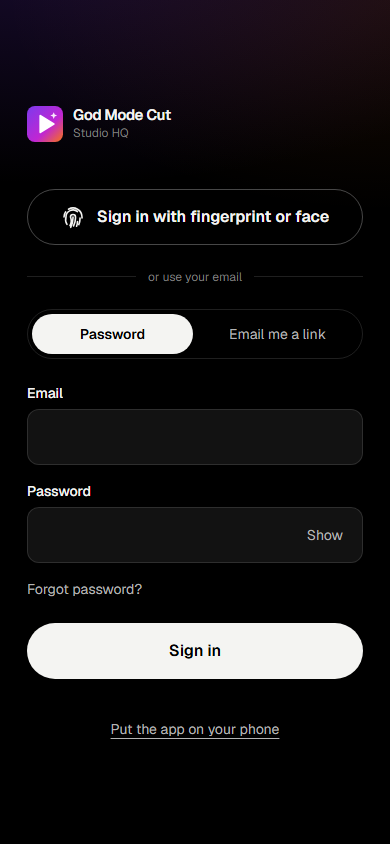
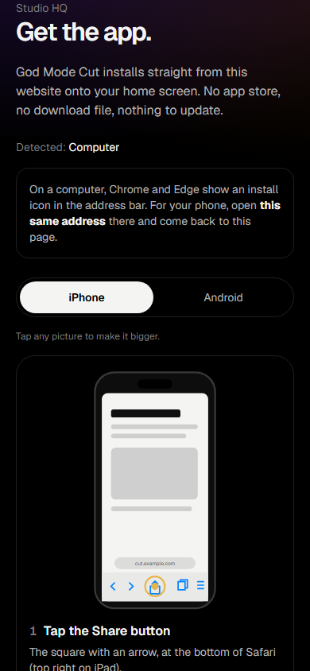
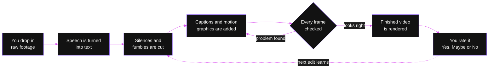
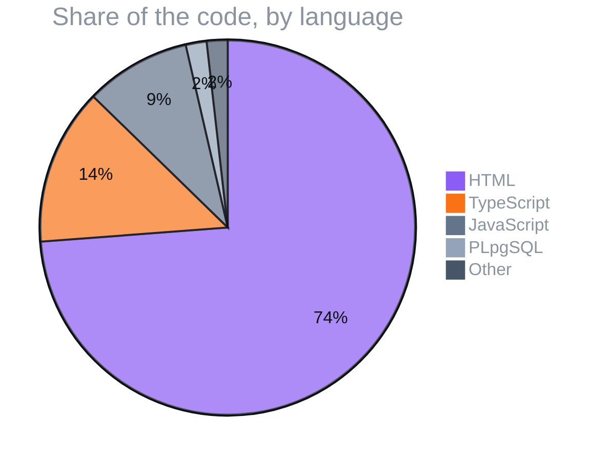

<p align="center">
  
</p>

<p align="center">
  
  
  
  
</p>
<p align="center">
  
  
  
  
  
  
  
  
  
  
  
</p>

<h3 align="center">Claude edits your videos. Your clients upload from their phone, approve the cut, and it posts itself.</h3>

<p align="center">
  <a href="#01--what-it-does">What it does</a> ·
  <a href="#02--screenshots">Screenshots</a> ·
  <a href="#03--how-an-edit-happens">How an edit happens</a> ·
  <a href="#04--the-life-of-a-client-video">The life of a client video</a> ·
  <a href="#05--part-of-claude-business-god-mode">Part of Claude Business God Mode</a> ·
  <a href="#06--what-its-written-in">What it's written in</a> ·
  <a href="#field-manual">Field manual</a> ·
  <a href="#license">License</a>
</p>

> [!TIP]
> **🤖 Pasted this link into Claude or ChatGPT?** AI assistants: read [`docs/AI_GUIDE.md`](https://raw.githubusercontent.com/F0rger123/claude-video-editing-god-mode/main/docs/AI_GUIDE.md) first. It explains what this is in plain words, which questions to ask, and how to set it up step by step. Plain-text index: [`llms.txt`](https://raw.githubusercontent.com/F0rger123/claude-video-editing-god-mode/main/llms.txt).


<p align="center"></p>

## 01 · What it does

**Claude Video Editing God Mode** turns Claude Code into a video editor. Hand it raw footage and it cuts the dead air and fumbled lines, adds captions and motion graphics, checks every frame and renders a finished reel, Short or long-form video, all on your own computer. **God Mode Cut**, the phone app in `app/`, adds the client side: uploads, approvals, review and scheduled posting.

| | |
|---|---|
| **16 editing skills** | Reels, Shorts, long-form, silence and mistake cutting, story planning, motion beats, showreels, website-to-video. Mirrored for Codex. |
| **406 motion-graphics cards** | Two ready-made style packs with editable text slots, plus whole-scene templates |
| **Free local pipeline** | Transcription, cutting and rendering run on your machine. No paid API needed. |
| **Hands-off editing** | Drop clips in an inbox folder; Claude returns 1 to 6 options and learns from your Yes / Maybe / No ratings |
| **God Mode Cut phone app** | Clients install it from your site, upload from the camera roll, review versions and approve. White-label. |
| **Your taste, locked in** | A brand profile holds your caption look, reference reels and ratings, so every edit matches |

**Quick start**

```bash
git clone https://github.com/F0rger123/claude-video-editing-god-mode.git
cd claude-video-editing-god-mode
npm install
npm run setup        # checks Node 22+, FFmpeg, Chrome and the renderer
npm run demo         # renders a starter video, no footage or API key needed
```

Then open the folder in Claude Code and say: *"Edit raw/my-clip.mp4 into a 30-second Instagram reel with captions."*

## 02 · Screenshots

<p align="center">
  
  &nbsp;&nbsp;
  
</p>
<p align="center"><sub>God Mode Cut on a phone: sign in, then add it to the home screen. No app store.</sub></p>

## 03 · How an edit happens



## 04 · The life of a client video


## 05 · Part of Claude Business God Mode

<table>
<tr>
<td align="center" width="25%"><a href="https://github.com/F0rger123/claude-business-god-mode"><b>👑 Business God Mode</b></a><br><sub>the umbrella: run a whole business with Claude</sub></td>
<td align="center" width="25%"><a href="https://github.com/F0rger123/claude-meta-ads-god-mode"><b>📣 Meta Ads God Mode</b></a><br><sub>paid media, paused-first, approval-gated</sub></td>
<td align="center" width="25%"><a href="https://github.com/F0rger123/CLAUDE-SEO-GOD-MODE"><b>🔎 SEO God Mode</b></a><br><sub>audits, local SEO, GSC, AI search</sub></td>
<td align="center" width="25%"><a href="https://github.com/F0rger123/ultimate-crm-template"><b>📇 Ultimate CRM Template</b></a><br><sub>leads, jobs, invoices, SMS, AI assistant</sub></td>
</tr>
</table>

## 06 · What it's written in



<p align="center"></p>

## Field manual

## ⚡ Quick start

```bash
git clone https://github.com/F0rger123/claude-video-editing-god-mode.git
cd claude-video-editing-god-mode
npm install
npm run setup        # checks Node 22+, FFmpeg, Chrome and the HyperFrames toolchain
npm run demo         # renders a synthetic starter video, no footage or API key needed
```

Then open the folder in Claude Code and say:

```text
Edit raw/my-clip.mp4 into a 30-second Instagram reel. Hook in the first second, captions, motion-graphics B-roll for every point.
```

**Install as a Claude Code plugin instead** (skills only, no workspace):

```text
/plugin marketplace add F0rger123/claude-video-editing-god-mode
/plugin install video-editing-god-mode@claude-video-editing-god-mode
```

## 🎬 What you get

| | |
|---|---|
| **16 editing skills** | Reels, Shorts, long-form, silence and mistake cutting, story planning, motion beats, showreels, website-to-video. Mirrored for Codex in `.agents/skills/`. |
| **406 motion-graphics cards** | Two style packs (`style-library/01-vox-explainer`, `02-kallaway`) with manifests, CSS tokens and editable slots, plus two scene templates. |
| **Free local pipeline** | `transcribe:local` (whisper.cpp, GPU or CPU), Robust Video Matting head pop-outs (`scripts/matte-rvm.py`), preflight and beat-sync validators. No paid API required. |
| **Unattended editing** | `scripts/drive-inbox.mjs` watches an inbox folder, runs `claude -p` with the right skill and brand profile, returns 1 to 6 options, learns from your Yes/Maybe/No ratings. |
| **God Mode Cut PWA** | Phone-first app in `app/`: uploads, approval rules, AI-edit queue, versioned review, client portal, captions, Buffer scheduling, passkey sign-in. White-label by env vars. |
| **Brand taste system** | `brands/example-brand/` (locked caption spec, ratings, inspiration notes) and `CLAUDE.local.example.md` for your personal house rules. |
| **Editing playbook** | [`docs/EDITING-PLAYBOOK.md`](docs/EDITING-PLAYBOOK.md) and [`MOTION_PHILOSOPHY.md`](MOTION_PHILOSOPHY.md): the measured house style every skill follows. |

## 🧠 The skills

| Skill | Use it when you want to |
|---|---|
| [`video-editing-god-mode`](.claude/skills/video-editing-god-mode/SKILL.md) | **Start here.** Routes the request and enforces the house rules |
| [`short-form-edit`](.claude/skills/short-form-edit/SKILL.md) | Turn talking-head footage into a reel, YouTube Short, TikTok or short ad |
| [`edit-video`](.claude/skills/edit-video/SKILL.md) | Do a complete long-form (16:9) edit, transcript to verified render |
| [`cut-silences`](.claude/skills/cut-silences/SKILL.md) | Remove dead air and tighten pacing |
| [`cut-mistakes`](.claude/skills/cut-mistakes/SKILL.md) | Remove stutters, repeated words, false starts and retakes |
| [`video-storytelling`](.claude/skills/video-storytelling/SKILL.md) | Build the visual layer as one persistent world the camera moves through |
| [`hyperframes-video-beats`](.claude/skills/hyperframes-video-beats/SKILL.md) | Plan, time and validate motion-graphic beats for long-form |
| [`make-a-video`](.claude/skills/make-a-video/SKILL.md) | Make a video from scratch, beginner friendly |
| [`motion-showreel`](.claude/skills/motion-showreel/SKILL.md) | Build a 10 to 30 second brand reel or motion showreel |
| [`website-to-hyperframes`](.claude/skills/website-to-hyperframes/SKILL.md) | Turn a website into a promo video |
| [`style-library`](.claude/skills/style-library/SKILL.md) | Pick, customize or extend the card library |
| [`hyperframes`](.claude/skills/hyperframes/SKILL.md) · [`hyperframes-cli`](.claude/skills/hyperframes-cli/SKILL.md) · [`hyperframes-registry`](.claude/skills/hyperframes-registry/SKILL.md) · [`gsap`](.claude/skills/gsap/SKILL.md) | Write, lint, preview and render HTML video compositions |
| [`short-form-video`](.claude/skills/short-form-video/SKILL.md) | Maintain the legacy teaching compositions |

## 📱 God Mode Cut: the phone app (details)

Clients install it from your website (no app store), drop raw clips from the camera roll, and approve the finished
cut. You see every job in one inbox.

- **Approval gate.** Manual, auto, conditional or full-auto rules plus package limits decide what gets edited.
- **Review and revisions.** Versions, timestamped comments, change requests, client approval.
- **Scheduling.** Buffer GraphQL API, tracked by a 5-minute cron tick.
- **Client isolation.** Postgres RLS and narrow RPCs, proven by `app/supabase/tests/isolation.test.sql`.
- **White-label.** Set `NEXT_PUBLIC_APP_NAME`, `NEXT_PUBLIC_AGENCY_NAME` and `NEXT_PUBLIC_SITE_URL`.

Deploy (free tiers work): [`app/docs/DEPLOYMENT.md`](app/docs/DEPLOYMENT.md). Develop:

```bash
cd app
npm ci
cp .env.example .env.local     # Supabase URL + anon key, service role key, CRON_SECRET, BUFFER_API_KEY
npm run dev
```

## 🎨 Teach it your taste

1. `cp -r brands/example-brand raw-media/styles/<your-brand>` and edit `inspiration.md` with 3 to 7 reels you love.
2. Ask Claude: *"Study my reference reels and update the inspiration file."* It measures pacing, cuts, framing and type.
3. Approve a caption look once. It becomes the locked `captions.md` and `captions.css`.
4. Rate finished options Yes, Maybe or No. `ratings.json` steers every next edit.
5. `cp CLAUDE.local.example.md CLAUDE.local.md` for your personal rules (no music, which SFX, which tools).

**Your own asset packs** (purchased SFX, LUTs, overlay packs, fonts) go in `raw-media/`, which Git ignores. Describe
them in a `README.md` there and the skills will use them. They are never published by this repo.

## 🔐 Keys and cost

Nothing paid is required. Optional keys (`.env`, see [`docs/TOOLS-AND-API-KEYS.md`](docs/TOOLS-AND-API-KEYS.md)):
ElevenLabs Scribe or OpenAI Whisper for cloud transcription, Kie.ai or Gemini for generated assets,
`ANTHROPIC_API_KEY` in the app for server-side caption regeneration.

## 📜 Credits and license

MIT. Built on the [Herk Edit Kit](https://github.com/nateherkai/herk-edit-kit) by Nate Herk (MIT, plus the
pipeline grant in [`licenses/PIPELINE-USE-PERMISSION.txt`](licenses/PIPELINE-USE-PERMISSION.txt)) and
[HyperFrames](https://github.com/heygen-com/hyperframes) (Apache-2.0, [`licenses/HYPERFRAMES-LICENSE`](licenses/HYPERFRAMES-LICENSE)).
See [`THIRD_PARTY_NOTICES.md`](THIRD_PARTY_NOTICES.md). GSAP keeps its own license. Style names such as Vox and
Kallaway are aesthetic references only, not endorsements. Teaching example videos from the original kit are not
included; get them from the upstream repository.

## License

Released under the [MIT License](LICENSE). Use it, fork it, ship it.

<p align="center"></p>

<p align="center">
  <sub>Built by <a href="https://github.com/F0rger123"><b>@F0rger123</b></a> · MIT licensed</sub>
</p>
