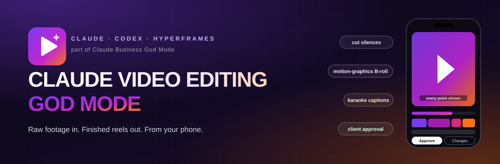

<p align="center">
  
</p>

# God Mode Cut (the phone app)

Mobile-first content operations PWA, part of [Claude Video Editing God Mode](../README.md): uploads, pre-edit
approval, AI editing (through the editing workspace at the repo root), review, revisions, client approvals,
captions, scheduling and Buffer publishing.

<p align="center">
  
  
</p>

| Capability | Detail |
|---|---|
| **Phone-first PWA** | Install to the home screen, upload clips straight from the camera roll |
| **Approval gate** | Manual, auto, conditional or full-auto rules plus package limits decide what gets edited |
| **AI editing bridge** | `bridge/` hands jobs to the editing workspace through an inbox folder protocol |
| **Review & revisions** | Versions, comments, change requests and client approvals |
| **Scheduling** | Buffer GraphQL API, tracked by a 5-minute cron tick |
| **Client isolation** | Postgres RLS and narrow RPCs, proven by `supabase/tests/isolation.test.sql` |
| **White-label** | `NEXT_PUBLIC_APP_NAME`, `NEXT_PUBLIC_APP_SHORT_NAME`, `NEXT_PUBLIC_AGENCY_NAME` (see `src/lib/brand.ts`) |

## How it fits together

```
Phone (PWA) --> Next.js on Cloudflare Workers --> Supabase (Postgres + RLS, Auth, Storage)
                       |   ^                              ^
        cron every 5m -+   | /api/cron/tick               | service role (local only)
                           |                              |
                 Buffer GraphQL API          bridge/ on the editing PC
                 (schedule + track)          +-> inbox folder -> scripts/drive-inbox.mjs (repo root)
```

- **Nothing is edited before the gate passes.** Uploads become one job per intended video (many clips, one job).
- **The editor is driven, not replaced.** Details: [docs/EDITOR-INTEGRATION.md](docs/EDITOR-INTEGRATION.md).
- Architecture and data model: [docs/ARCHITECTURE.md](docs/ARCHITECTURE.md). Deployment: [docs/DEPLOYMENT.md](docs/DEPLOYMENT.md).

## Develop

```bash
npm ci
cp .env.example .env.local     # Supabase URL + anon key, service role key, CRON_SECRET, BUFFER_API_KEY
npm run dev
```

| Command | Purpose |
| --- | --- |
| `npm run dev` | Next.js dev server |
| `npm run lint` / `npx tsc --noEmit` | Lint / types |
| `npm test` | Unit tests (domain rules + bridge contract) |
| `bash supabase/tests/run.sh` | Migrations + RLS isolation tests on a scratch Postgres (PG* env) |
| `npm run build` | Next.js production build |
| `npm run preview` / `npm run deploy` | OpenNext build for Cloudflare, local preview / deploy |
| `npm run bridge` / `npm run bridge:dry` | Editor bridge pass (editing PC only) |

## Roles

- **Owner / agency** (`content_staff`): everything, every workspace.
- **Client** (`content_members`): one workspace, independently toggled permissions
  (`can_upload`, `can_view_drafts`, `can_comment`, `can_request_changes`, `can_approve`,
  `can_view_calendar`, `can_view_published`, `can_download_final`, `can_trigger_editing`).
  Portal at `/portal/<slug>`, access revocable at any time.

## License

MIT, see the repository [`LICENSE`](../LICENSE).
