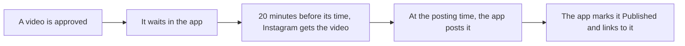

# Posting Reels straight to Instagram (no Buffer)

The app can post finished videos to Instagram as Reels (also shown in the feed) by itself.

## What happens



- Instagram can't hold a post for later, so the app posts it itself at the time. The database runs this
  every 2 minutes, so it posts within about 2 minutes of the time, even when the editing PC is off
  (`node scripts/setup-db-cron.mjs` set that up; `--remove` stops it).
- If Instagram can't process a video, the app tries up to 3 times, then alerts you.
- The sign-in lasts 60 days. The app renews it every week by itself.

## Who it works for

- **Your own accounts, right away.** They must be Professional accounts (Creator or Business). Switch in the
  Instagram app: Settings → Account type and tools → Switch to professional account. It's free.
- **Clients' accounts, after Meta approves the app** ("App Review" for `instagram_business_content_publish`).
  Until then, keep clients on Buffer for Instagram.

## One-time setup (owner, about 15 minutes)

1. Go to https://developers.facebook.com/apps and **Create app**. Use case: **Manage messaging & content on
   Instagram**. App type Business if asked. Name: "AZ Video Editor".
2. In the app: **Instagram → API setup with Instagram business login**.
   - Under **Set up Instagram business login → Business login settings**, add the redirect URL:
     `https://<your-app-domain>/api/instagram/callback`
   - Under **Generate access tokens**, tap **Add account** and sign in with your Instagram account. This
     gives your account access to your app while it's in development mode.
3. Copy the **Instagram app ID** and **Instagram app secret** shown on that page (not the Facebook App ID at
   the top) into the Worker as secrets (never into the code):

   ```bash
   npx wrangler secret put INSTAGRAM_APP_ID
   ```

   ```bash
   npx wrangler secret put INSTAGRAM_APP_SECRET
   ```

4. In the app, open your workspace's **Channels** tab (Settings → Connect your own accounts) and tap
   **Connect Instagram**.

Keep the Meta app in **Development** mode for your own accounts. Switching it to Live needs a privacy policy
URL and App Review.

## For clients later (App Review)

In the Meta app: **App Review → Permissions and features → `instagram_business_content_publish` → Request
advanced access**. Meta asks for a screen recording of a client connecting and a post going out, a privacy
policy URL, and business verification. It's free and usually takes a few days to a couple of weeks.

## Limits

- 100 posts per Instagram account per 24 hours.
- Video: MP4 (H.264 video, AAC audio), 3 seconds to 15 minutes, 9:16 looks best.
- Captions: up to 2,200 characters and 30 hashtags (extra hashtags are dropped).
- Each Instagram account posts for one client only.
- Sign-ins are stored on the server only (service role), never in the browser.
