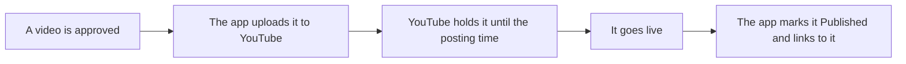

# Posting straight to YouTube (no Buffer)

The app can upload finished videos to YouTube by itself and schedule them for their posting time.
Buffer is still there for Instagram, TikTok and Facebook. A client can use both: YouTube direct,
the rest through Buffer.

## What happens



- Shorts: vertical videos under 3 minutes become Shorts automatically.
- If the posting time is less than 15 minutes away, the video goes live as soon as it uploads.
- If YouTube's daily limit is reached, the app tries again on the next pass.

## One-time setup (owner, about 10 minutes)

You do this once for the whole app, not once per client. It's free.

1. Go to https://console.cloud.google.com and create a project, for example "AZ Video Editor".
2. **APIs & Services → Library**: turn on **YouTube Data API v3**.
3. **Google Auth Platform → Branding**: app name "AZ Video Editor", your email as support and
   developer contact. Under **Audience**, pick **External**, then **Publish app** (in "Testing" mode, a
   sign-in only lasts 7 days).
4. **Data Access → Add scopes**: `.../auth/youtube.upload` and `.../auth/youtube.readonly`.
5. **Clients → Create client → Web application**. Authorised redirect URI:
   `https://<your-app-domain>/api/youtube/callback`
6. Copy the client ID and client secret into the Worker as secrets (never into the code):

   ```bash
   npx wrangler secret put GOOGLE_CLIENT_ID
   ```

   ```bash
   npx wrangler secret put GOOGLE_CLIENT_SECRET
   ```

   For local development, put the same two lines in `.env.local`.

7. In the app, open a client's **Channels** tab and tap **Connect YouTube**. Sign in with the Google account
   that owns the channel. For a client's channel, either sign in with their account, or ask them to add
   your Google account as a channel **Manager** in YouTube Studio (Settings → Permissions) and pick
   their channel when Google asks.

Google shows a "Google hasn't verified this app" screen until the app is verified. Tap **Advanced →
Go to AZ Video Editor**. That's expected for your own app.

## The audit: why videos might stay private

YouTube keeps every video private if it was uploaded through a Google project that hasn't passed
YouTube's API compliance audit. This applies to every new project. The app spots this: when a video is
still private 30 minutes after its posting time, you get a "YouTube kept a video private" alert. Make it
public in YouTube Studio, and the app marks it Published.

To remove the limit, apply once (free; Google replies in a few days to a few weeks):
https://support.google.com/youtube/contact/yt_api_form ("YouTube API Services - Audit and Quota
Extension"). Say it's an internal tool that uploads your agency's and your clients' own videos, at their
request, to their own channels.

## Limits

- Free daily quota: 10,000 units. One upload costs about 1,600 (around 6 uploads a day across all
  channels). The same audit form can ask for more.
- Each channel posts for one client only, like Buffer channels.
- Sign-ins are stored on the server only (service role), never in the browser.
